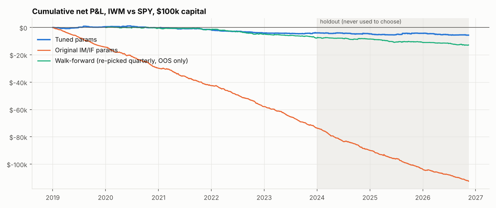
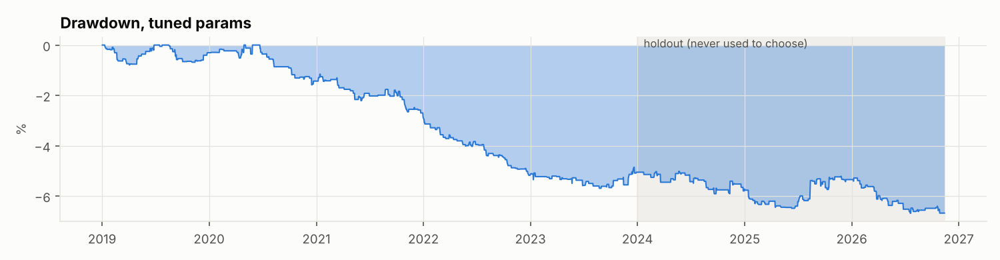
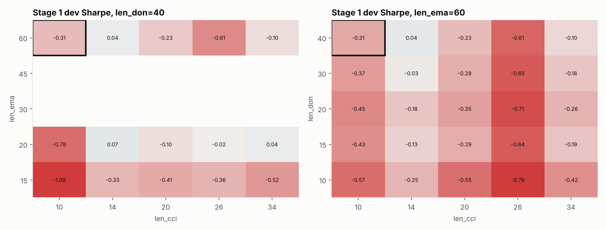
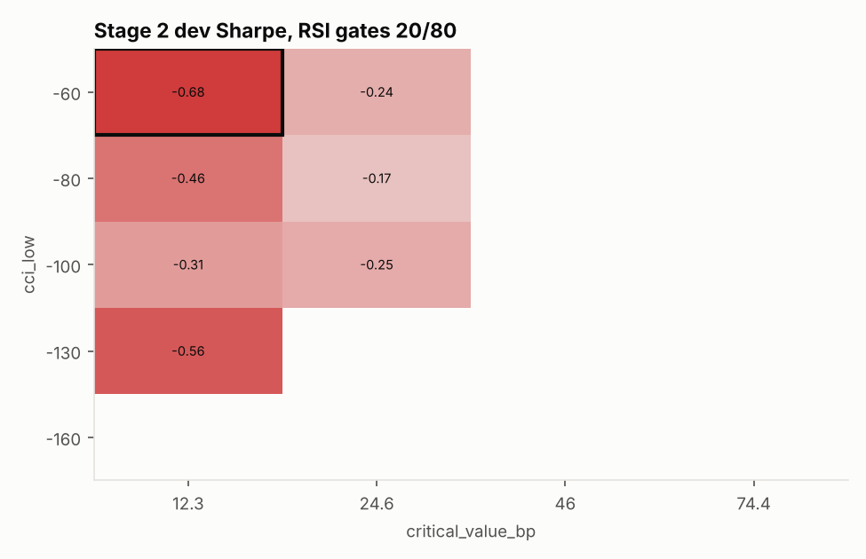
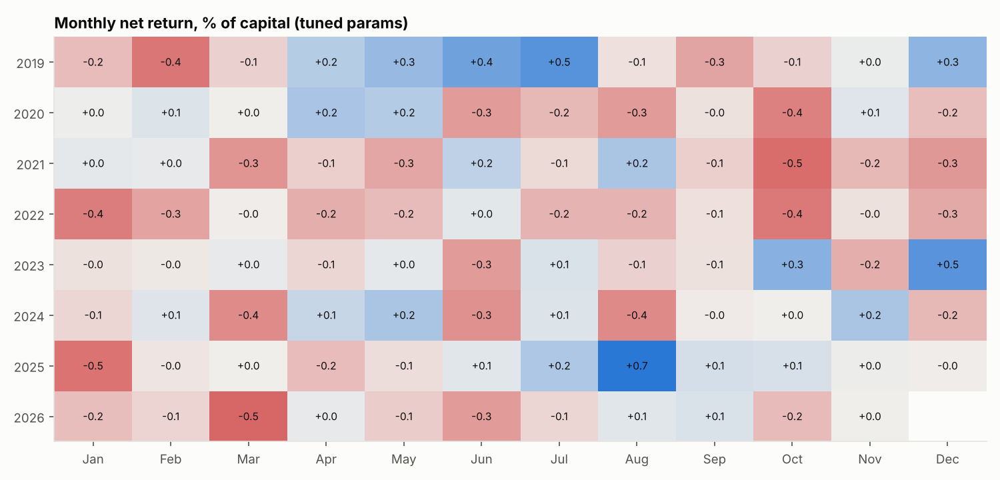
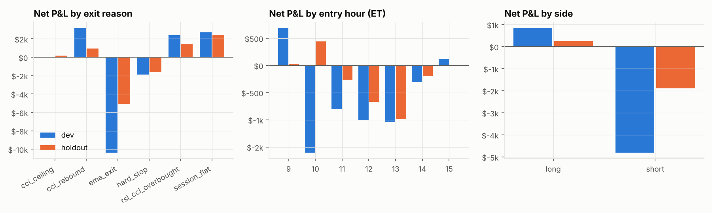

# Project A tuning report: IWM vs SPY (ETF proxy for RTY vs ES)

Dev period (parameters chosen here): start -> 2024-01-01. Holdout: 2024-01-01 -> end, never used to choose.
Costs: 1 tick ($0.01) slippage per leg per fill, no commission, ~$50k per leg, $100k capital.
Bar size chosen in stage 0: **10 min** (original IM/IF used 1 min).

Avg net per trade: dev $-13.25, holdout $-9.24.
See "Costs": the zero-slippage row shows whether there is any edge before trading costs.

## Findings

1. **The original IM/IF parameters lose heavily on IWM/SPY**: 1-minute bars, ~1,300 trades a year, 5-minute average hold, Sharpe about -10. Trading costs alone exceed any edge.
2. **No parameter set found has a positive edge.** Bar size helps most (1 min -> 10 min cuts trading ~20x), but the best plateau Sharpe on the dev period is still negative (-0.17), and the tuned set is negative on dev (-0.94) and holdout (-0.63).
3. **It is not just costs.** With zero slippage the tuned set is still negative (dev Sharpe -0.35). The signals have no edge on this pair before costs.
4. **Walk-forward (re-picking every quarter) is also negative** (OOS Sharpe -1.80), so there is no stable region to pick from.
5. **Where it loses**: the short-spread side (small caps weaken vs large caps) loses in both periods. The long side is slightly positive but has only 116 trades in 8 years. EMA-cross stop exits are the main source of loss; profit-taking exits and end-of-day exits are positive.
6. **Most losing hours**: 10:00-14:00 ET entries; the first 30 minutes after the open are the only positive bucket in dev.

Conclusion: the IM/IF rule set does not transfer to the US small/large-cap pair as is. Re-tuning cannot rescue it.

## Results

| | Ann. return | Sharpe | Max DD | Net | Trades | Win rate | Avg min |
|---|---|---|---|---|---|---|---|
| Tuned, dev | -0.8% | -0.94 | -5.7% | $-4k | 298 | 39% | 68 |
| Tuned, holdout | -0.6% | -0.63 | -1.7% | $-2k | 178 | 40% | 79 |
| Original params, dev | -23.4% | -10.38 | -73.6% | $-74k | 6369 | 27% | 5 |
| Original params, holdout | -15.8% | -9.57 | -38.9% | $-39k | 3987 | 29% | 5 |
| Walk-forward OOS | -2.1% | -1.80 | -13.2% | $-13k | – | nan% | nan |

## Parameters

| Parameter | Original (IM/IF) | Tuned |
|---|---|---|
| `bar_minutes` | 1 | **10** |
| `center_window` | 390 | **39** |
| `len_cci` | 20 | **10** |
| `len_don` | 20 | **40** |
| `len_ema` | 30 | **60** |
| `cci_low` | -100.0 | **-60.0** |
| `rsi_long_min` | 80.0 | **80.0** |
| `rsi_short_min` | 20.0 | **20.0** |
| `critical_value_bp` | 20.0 | **12.3** |
| `hard_stop_bp` | 40.0 | **46.0** |
| `max_close_to_ema_bp` | 15.0 | **18.7** |
| `cci_exit_low` | -150.0 | **-200.0** |

Spread scale on dev (bp): dev_q50=24.62, dev_q75=45.97, dev_q90=74.43, abs_bar_move_median=5.53, abs_bar_move_q90=18.67

Stage 0, bar size (stage-1 grid at original thresholds):

| Bar (min) | Best plateau Sharpe | Grid median Sharpe | Trades at best |
|---|---|---|---|
| 1 | -8.32 | -10.30 | 4351 |
| 3 | -2.22 | -3.49 | 629 |
| 5 | -0.81 | -1.67 | 157 |
| 10 | -0.17 | -0.41 | 123 |
| 15 | -0.23 | -0.80 | 108 |

| Stage | Pick | Dev Sharpe | Plateau Sharpe | Dev trades |
|---|---|---|---|---|
| stage1 | len_cci=10, len_don=40, len_ema=60 | -0.31 | -0.17 | 123 |
| stage2 | cci_low=-60.0, rsi_long_min=80.0, rsi_short_min=20.0, critical_value_bp=12.3 | -0.68 | -1.23 | 238 |
| stage3 | hard_stop_bp=46.0, max_close_to_ema_bp=18.7, cci_exit_low=-200.0 | -0.94 | -1.04 | 298 |

Heatmap blanks = fewer than 100 dev trades (not scored).

## Costs

| Slippage (ticks/leg/fill) | Dev Sharpe | Dev ann. | Holdout Sharpe | Holdout ann. |
|---|---|---|---|---|
| 0 | -0.35 | -0.3% | -0.23 | -0.2% |
| 0.5 | -0.65 | -0.5% | -0.43 | -0.4% |
| 1 | -0.94 | -0.8% | -0.63 | -0.6% |
| 2 | -1.51 | -1.3% | -1.02 | -0.9% |

## Breakdown

